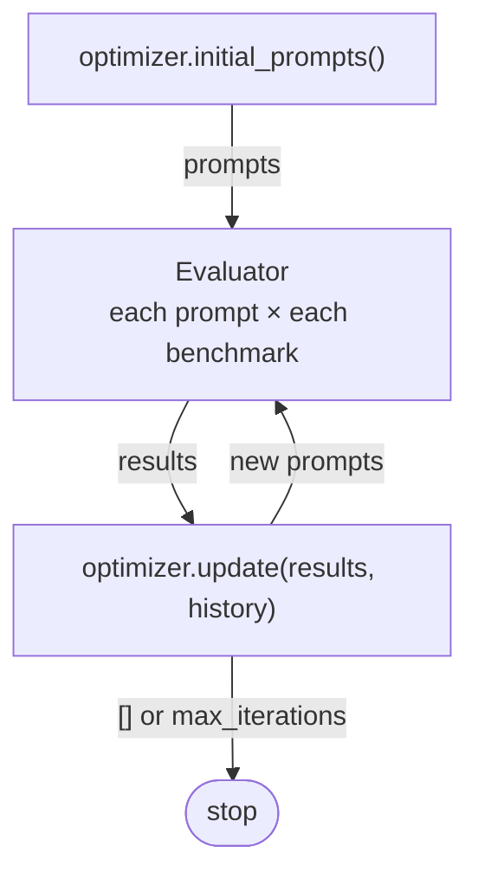

# skillopt — reasoning-skill optimization

## Overview

`skillopt` searches for **reasoning skills**, i.e. prompts, that keep a fixed LLM (default Qwen3-8B) accurate while
using fewer tokens, thinking included. Benchmarks: GSM8K and BBH.

- **You write** one `Optimizer` that proposes prompts and updates them from the results.
- **The framework** evaluates each prompt on each benchmark, returns accuracy and token usage, and saves everything.



## Requirements

Python >= 3.10. Real runs need one 24 GB GPU; `--mock` needs none.

| Install | Adds | For |
|---|---|---|
| `pip install -e .` | `pyyaml` | core |
| `pip install -e .[dev]` | `pytest` | tests, `--mock` |
| `pip install -e .[data]` | `datasets` | all benchmarks from Hugging Face (GSM8K, BBH, MATH-500, AIME, AMC, BBEH) |
| `pip install -e .[math]` | `math-verify` (SymPy) | symbolic-equivalence math scoring (MATH-500, ...), optional |
| `pip install -e .[vllm]` | `vllm` | `*-vllm` presets (default), Linux / WSL2 only |
| `pip install -e .[hf]` | `torch`, `transformers`, `accelerate`, `bitsandbytes` | `hf` backend (no bundled preset; add one with `backend: hf`) |

A default real run needs `.[vllm,data]`. The `openai` backend (OpenAI API or a local OpenAI-compatible server) needs no
extras (add a preset with `backend: openai`).

## Optimizer

```python
from skillopt.optimizer import Optimizer, register_optimizer
from skillopt.skills import Skill

@register_optimizer("mine")
class Mine(Optimizer):                                        # self.llm, self.params
    def initial_prompts(self) -> list[Skill]: ...             # round 0
    def update(self, results, history) -> list[Skill]: ...    # [] = stop
```

- `results`: this round's `SkillEvaluation`s, in prompt order. `history`: earlier rounds, oldest first.
- Add one file to `skillopt/optimizer/algorithms/` and set `optimizer: {name: mine, ...}`.
- Fill in the template `my_optimizer.py`; `opro.py` is a worked example.
- Baseline skills `direct`, `cot`, `cod`: `get_baseline` in `skillopt/baselines.py`.
- Optional: attach `origin=SkillOrigin(parents=[...], operation="...", note="...")` to a returned `Skill`; the run report shows it as is.

## Evaluator results

```
SkillEvaluation       skill, skill_id, split, results
  results[bench]  ->  EvalResult
                        n, accuracy, failures(k), items
                        avg_input_tokens, avg_output_tokens, avg_reasoning_tokens, avg_total_tokens, avg_latency
                        num_truncated, truncation_rate
```

`avg_output_tokens` includes thinking. Each item keeps the question, prediction, gold, correctness, usage, texts
and `truncated` (the generation hit `max_tokens`).

## Config

`configs/config.yaml`:

```yaml
benchmarks:                                                    # bbh train / val are per task
  gsm8k: {source: hf, train: 200, val: 200}
  bbh:   {source: hf, tasks: all, heldout: [web_of_lies], train: 10, val: 10}
  math500:  {source: hf, train: 50, val: 50}
  bbeh:     {source: hf, tasks: all, mini: false, train: 2, val: 2}            # train / val per task
  aime2024:   {source: hf}                                       # test-only
  aime2025:   {source: hf}
  amc2023:    {source: hf}
  musr:       {source: hf, tasks: all, train: 10, val: 10}          # 3 narrative tasks, train/val per task
  folio:      {source: hf, train: 40, val: 40}                      # formal FOL entailment
  lsat_ar:    {source: hf, train: 20, val: 20}                      # LSAT logic games
  strategyqa: {source: hf, train: 40, val: 40}                      # multi-hop commonsense QA
  mmlu_pro:   {source: hf, categories: non_math, train: 4, val: 4}  # 13 non-math disciplines, per category
optimizer: {name: my_optimizer}                                # other keys -> constructor
max_iterations: 5                                              # max update() calls
eval: {skills: [direct, cot, cod], split: test, limit: null}   # --eval-only only
```

Also `llm` (target / optimizer presets), `hardware.vram_gb`, `evaluator.batch_size`, `run`, `seed`.

## Benchmarks

| | GSM8K | BBH (BIG-Bench Hard) |
|---|---|---|
| Content | grade-school math | 27 reasoning tasks |
| Answer | number | letter, True/False, Yes/No, ... |
| Original | train 7,473 · test 1,319 | test only, 6,511 total |
| Links | [paper](https://arxiv.org/abs/2110.14168) · [openai/gsm8k](https://huggingface.co/datasets/openai/gsm8k) | [paper](https://aclanthology.org/2023.findings-acl.824/) · [lukaemon/bbh](https://huggingface.co/datasets/lukaemon/bbh) |

| Split | Used for | GSM8K | BBH |
|---|---|---|---|
| `train` | every loop round | 200 | 10 per task (260) |
| `val` | picking the final skill | 200 | 10 per task (260) |
| `test` | final score | 1,319 | rest of each task (5,741) |
| `heldout` | unseen tasks | — | web_of_lies (250) |

- GSM8K `train` / `val` come from the official train set. BBH has none, so each task is split.
- The loop runs only `train`; run the others with `--eval-only --split <split>`.
- BBH `tasks:` / `heldout:` take task names, `algorithmic`, `nlu` or `all` (`BBH_TASK_GROUPS` in `bbh.py`).

### Long-reasoning benchmarks

| Name | Config key | Content | Size | Answer | Links |
|---|---|---|---|---|---|
| MATH-500 | `math500` | competition math | 500 | LaTeX in `\boxed{}` | [MATH paper](https://arxiv.org/abs/2103.03874) · [subset](https://arxiv.org/abs/2305.20050) · [HuggingFaceH4/MATH-500](https://huggingface.co/datasets/HuggingFaceH4/MATH-500) |
| AIME 2024 | `aime2024` | olympiad math | 30 | integer 0-999 | [HuggingFaceH4/aime_2024](https://huggingface.co/datasets/HuggingFaceH4/aime_2024) |
| AIME 2025 | `aime2025` | olympiad math | 30 | integer 0-999 | [math-ai/aime25](https://huggingface.co/datasets/math-ai/aime25) |
| AMC 2023 | `amc2023` | competition math | 40 | number | [math-ai/amc23](https://huggingface.co/datasets/math-ai/amc23) |
| BBEH | `bbeh` | 23 hard reasoning tasks | 4,520 | free-form, task-specific | [paper](https://arxiv.org/abs/2502.19187) · [BBEH/bbeh](https://huggingface.co/datasets/BBEH/bbeh) |

| Split | MATH-500 | BBEH | AIME 2024 / AIME 2025 / AMC 2023 |
|---|---|---|---|
| `train` | 50 | 2 per task (46) | — |
| `val` | 50 | 2 per task (46) | — |
| `test` | 400 | rest of each task (4,428) | all (30 / 30 / 40) |

- Each ships one pool: seeded shuffle, first `train` -> train, next `val` -> val, rest -> test. `train` / `val`
  exist only when set > 0, so test-only sets skip the loop (`--eval-only --split test` runs them).
- Math answers are taken from the last `\boxed{}` and compared by equivalence (`\frac{1}{2}` = `0.5`, `025` = `25`, ...); if the rules disagree and `.[math]` is installed, a Math-Verify symbolic check decides (5 s limit; timeout or parse failure = wrong), otherwise only the rules apply.
- BBEH uses the official fuzzy matcher; `mini: true` keeps BBEH-mini (20 per task, 460).
- Long-reasoning items can run up to ~30k tokens each; lower `train` or use `--limit` to bound cost.

### Non-math reasoning benchmarks

| Name | Config key | Reasoning type | Size (train / val / test) | Answer | Links |
|---|---|---|---|---|---|
| MuSR | `musr` | Long-narrative abductive & deductive | 756 across 3 tasks (30 / 30 / 696) | option letter `(A)`–`(E)` | [paper](https://arxiv.org/abs/2310.16049) · [TAUR-Lab/MuSR](https://huggingface.co/datasets/TAUR-Lab/MuSR) |
| FOLIO | `folio` | Formal first-order logic entailment | 1,204 (40 / 40 / 203 official val) | `True` / `False` / `Uncertain` | [paper](https://arxiv.org/abs/2209.00840) · [tasksource/folio](https://huggingface.co/datasets/tasksource/folio) |
| LSAT-AR | `lsat_ar` | Constraint satisfaction & logic games | 230 (20 / 20 / 190) | option letter `(A)`–`(E)` | [AGIEval](https://arxiv.org/abs/2304.06364) · [hails/agieval-lsat-ar](https://huggingface.co/datasets/hails/agieval-lsat-ar) |
| StrategyQA | `strategyqa` | Multi-hop implicit commonsense QA | 2,290 (40 / 40 / 687 official test) | `Yes` / `No` | [paper](https://arxiv.org/abs/2101.02235) · [ChilleD/StrategyQA](https://huggingface.co/datasets/ChilleD/StrategyQA) |
| MMLU-Pro | `mmlu_pro` | 10-option cross-domain reasoning | 10,681 in `non_math` / 12,032 all (52 / 52 / rest) | option letter `(A)`–`(J)` | [paper](https://arxiv.org/abs/2406.01574) · [TIGER-Lab/MMLU-Pro](https://huggingface.co/datasets/TIGER-Lab/MMLU-Pro) |

- **Chain of Draft tasks:** `gsm8k`, BBH `date_understanding`, and BBH `sports_understanding` are already included under `gsm8k` and `bbh`; `strategyqa` adds multi-hop commonsense QA from Sketch-of-Thought alongside `musr`, `folio`, `lsat_ar`, and `mmlu_pro`.
- `musr` splits per task (`murder_mysteries`, `object_placements`, `team_allocation`); `mmlu_pro` splits per category (`categories:` accepts `non_math`, `stem`, `humanities_social`, `all`, or category names; `heldout:` works on both).
- `folio` and `strategyqa` draw disjoint seeded `train` / `val` samples from their official train splits and evaluate `test` on their official held-out sets (`validation` for FOLIO, `test` for StrategyQA).

## Running

```bash
python run.py --mock --set optimizer.name=opro                            # no GPU, sample data
python run.py                                                             # real loop on train
python run.py --set max_iterations=10 --set benchmarks.gsm8k.train=100    # override any key
python run.py --eval-only --skills cot <skill.json> --split test          # evaluate skills
```

Progress logs go to stderr (INFO default): `--log-level DEBUG|INFO|WARNING|ERROR`, `-v` (= DEBUG), `-q` (= WARNING); saved outputs are unaffected.

`--mock` with the default `my_optimizer` raises `NotImplementedError` until it is filled in.

## Run directory

```
runs/<timestamp>_<name>/
├── config.yaml, meta.json, run.json
├── report.html                              run report (rewritten every round)
├── usage/{target,optimizer}.json
└── rounds/000/                              000 = initial prompts, 001+ = update() outputs
    ├── skills/<skill_id>.json
    ├── results/<bench>/<skill_id>.jsonl     per item
    ├── summary.json
    └── usage.json                           cumulative
```

`--eval-only` writes `runs/<timestamp>_<name>_eval/`.

`skills/<skill_id>.json` holds the skill (with `origin`, or null) plus `num_tokens`: the size of the skill itself
(instruction + few-shot demos) in target-tokenizer tokens, null if the tokenizer is unavailable.

## Run report

`runs/<run>/report.html` is one self-contained page (no server, no external files, light and dark mode). It is
rewritten after every round and refreshes itself every 5 seconds while the run is in progress, keeping the
selected node, the tree view and the scroll position; open it in a browser during or after training. To rebuild
it from a saved run:

```bash
python -m skillopt.report runs/<run>
```

- Prompt evolution tree (first): one column per round, one node per evaluated skill with per-benchmark accuracy
  bars and avg output tokens, edges from what it was derived from. Node color is the operation only. Drag to pan,
  scroll or use the buttons to zoom; hover to highlight ancestors and descendants. An optimizer describes origins
  with `SkillOrigin` (`parents`: ids, primary first; `operation`: free label; `note`: free text); without it the
  report shows `parent_id`.
- Detail panel: click a node to see the full instruction, skill size (`num_tokens`), parents and children, the
  optimizer note, a word diff against the first parent, per-benchmark metrics and a few incorrect items.
- Summary cards: round, status, skill counts, cumulative token usage.
- Per-benchmark charts: accuracy and avg output tokens by round; click a point to open that skill.
- Skills table (collapsed): every evaluated skill in saved order with accuracy, tokens and truncation rate.

The report only displays what was saved; it never ranks or picks skills. Only you can sort the table, by
clicking a column header.

## Models

Presets in `configs/models/`: `qwen3-8b-fp16-vllm` (default), `qwen3-8b-vllm` (bf16), `mock`. bf16 needs
compute capability >= 8.0 (Ampere or newer); use fp16 otherwise (e.g. TITAN RTX, 7.5). On a bf16-capable GPU:
`--set llm.target.preset=qwen3-8b-vllm --set llm.optimizer.preset=qwen3-8b-vllm`. Both use the native 32,768-token
context (no YaRN) with up to 30,720 target max tokens, and reserve 0.92 × 24 = 22.1 GB. Roles with the same model share one engine, and `check_vram_budget` stops the run before loading
if `hardware.vram_gb` is exceeded. Other models or backends: add a preset file to `configs/models/`.

## Extending

| Add | How |
|---|---|
| Optimizer | see [Optimizer](#optimizer) |
| LLM backend | subclass `BaseLLM`, implement `_generate`, `@register_llm("name")`, import in `skillopt/llm/__init__.py`, add a preset |
| Benchmark | subclass `Benchmark`, `@register_benchmark("name")`, import in `skillopt/benchmarks/__init__.py`, add to `benchmarks:` |
