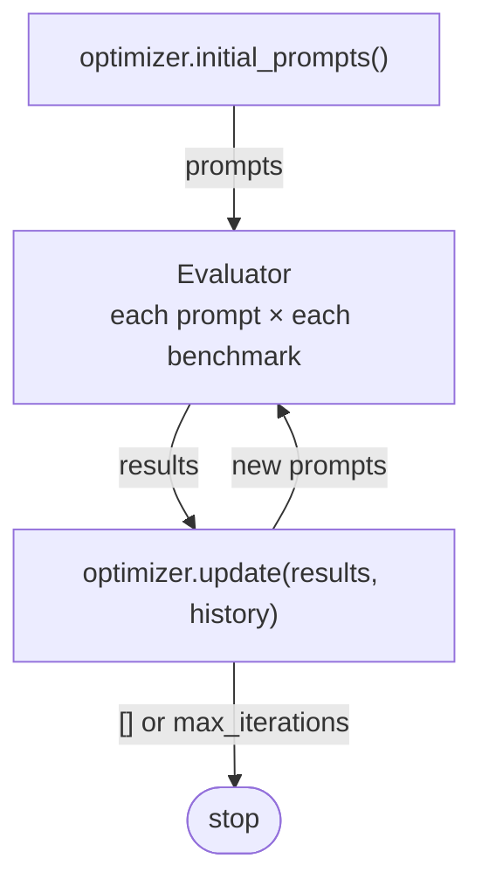

# skillopt — reasoning-skill optimization

## Overview

`skillopt` searches for **reasoning skills**, i.e. prompts, that keep a fixed LLM (default Qwen3-8B) accurate while
using fewer tokens, thinking included. Benchmarks: GSM8K and BBH.

- **You write** one `Optimizer` that proposes prompts and updates them from the results.
- **The framework** evaluates each prompt on each benchmark, returns accuracy and token usage, and saves everything.



## Requirements

Python >= 3.10. Real runs need one 24 GB GPU; `--mock` needs none.

| Install | Adds | For |
|---|---|---|
| `pip install -e .` | `pyyaml` | core |
| `pip install -e .[dev]` | `pytest` | tests, `--mock` |
| `pip install -e .[data]` | `datasets` | GSM8K / BBH from Hugging Face |
| `pip install -e .[vllm]` | `vllm` | `*-vllm` presets (default), Linux / WSL2 only |
| `pip install -e .[hf]` | `torch`, `transformers`, `accelerate`, `bitsandbytes` | `hf` backend (no bundled preset; add one with `backend: hf`) |

A default real run needs `.[vllm,data]`. The `openai` backend (OpenAI API or a local OpenAI-compatible server) needs no
extras (add a preset with `backend: openai`).

## Optimizer

```python
from skillopt.optimizer import Optimizer, register_optimizer
from skillopt.skills import Skill

@register_optimizer("mine")
class Mine(Optimizer):                                        # self.llm, self.params
    def initial_prompts(self) -> list[Skill]: ...             # round 0
    def update(self, results, history) -> list[Skill]: ...    # [] = stop
```

- `results`: this round's `SkillEvaluation`s, in prompt order. `history`: earlier rounds, oldest first.
- Add one file to `skillopt/optimizer/algorithms/` and set `optimizer: {name: mine, ...}`.
- Fill in the template `my_optimizer.py`; `opro.py` is a worked example.
- Baseline skills `direct`, `cot`, `cod`: `get_baseline` in `skillopt/baselines.py`.

## Evaluator results

```
SkillEvaluation       skill, skill_id, split, results
  results[bench]  ->  EvalResult
                        n, accuracy, failures(k), items
                        avg_input_tokens, avg_output_tokens, avg_reasoning_tokens, avg_total_tokens, avg_latency
```

`avg_output_tokens` includes thinking. Each item keeps the question, prediction, gold, correctness, usage and texts.

## Config

`configs/config.yaml`:

```yaml
benchmarks:                                                    # bbh train / val are per task
  gsm8k: {source: hf, train: 200, val: 200}
  bbh:   {source: hf, tasks: all, heldout: [web_of_lies], train: 10, val: 10}
optimizer: {name: my_optimizer}                                # other keys -> constructor
max_iterations: 5                                              # max update() calls
eval: {skills: [direct, cot, cod], split: test, limit: null}   # --eval-only only
```

Also `llm` (target / optimizer presets), `hardware.vram_gb`, `evaluator.batch_size`, `run`, `seed`.

## Benchmarks

| | GSM8K | BBH (BIG-Bench Hard) |
|---|---|---|
| Content | grade-school math | 27 reasoning tasks |
| Answer | number | letter, True/False, Yes/No, ... |
| Original | train 7,473 · test 1,319 | test only, 6,511 total |
| Links | [paper](https://arxiv.org/abs/2110.14168) · [openai/gsm8k](https://huggingface.co/datasets/openai/gsm8k) | [paper](https://aclanthology.org/2023.findings-acl.824/) · [lukaemon/bbh](https://huggingface.co/datasets/lukaemon/bbh) |

| Split | Used for | GSM8K | BBH |
|---|---|---|---|
| `train` | every loop round | 200 | 10 per task (260) |
| `val` | picking the final skill | 200 | 10 per task (260) |
| `test` | final score | 1,319 | rest of each task (5,741) |
| `heldout` | unseen tasks | — | web_of_lies (250) |

- GSM8K `train` / `val` come from the official train set. BBH has none, so each task is split.
- The loop runs only `train`; run the others with `--eval-only --split <split>`.
- BBH `tasks:` / `heldout:` take task names, `algorithmic`, `nlu` or `all` (`BBH_TASK_GROUPS` in `bbh.py`).

## Running

```bash
python run.py --mock --set optimizer.name=opro                            # no GPU, sample data
python run.py                                                             # real loop on train
python run.py --set max_iterations=10 --set benchmarks.gsm8k.train=100    # override any key
python run.py --eval-only --skills cot <skill.json> --split test          # evaluate skills
```

`--mock` with the default `my_optimizer` raises `NotImplementedError` until it is filled in.

## Run directory

```
runs/<timestamp>_<name>/
├── config.yaml, meta.json, run.json
├── usage/{target,optimizer}.json
└── rounds/000/                              000 = initial prompts, 001+ = update() outputs
    ├── skills/<skill_id>.json
    ├── results/<bench>/<skill_id>.jsonl     per item
    ├── summary.json
    └── usage.json                           cumulative
```

`--eval-only` writes `runs/<timestamp>_<name>_eval/`.

## Models

Presets in `configs/models/`: `qwen3-8b-fp16-vllm` (default), `qwen3-8b-vllm` (bf16), `mock`. bf16 needs
compute capability >= 8.0 (Ampere or newer); use fp16 otherwise (e.g. TITAN RTX, 7.5). On a bf16-capable GPU:
`--set llm.target.preset=qwen3-8b-vllm --set llm.optimizer.preset=qwen3-8b-vllm`. The default reserves
0.85 × 24 = 20.4 GB. Roles with the same model share one engine, and `check_vram_budget` stops the run before loading
if `hardware.vram_gb` is exceeded. Other models or backends: add a preset file to `configs/models/`.

## Extending

| Add | How |
|---|---|
| Optimizer | see [Optimizer](#optimizer) |
| LLM backend | subclass `BaseLLM`, implement `_generate`, `@register_llm("name")`, import in `skillopt/llm/__init__.py`, add a preset |
| Benchmark | subclass `Benchmark`, `@register_benchmark("name")`, import in `skillopt/benchmarks/__init__.py`, add to `benchmarks:` |
